# Pico GTM Brain

The governed, machine-readable go-to-market for **Pico**, the AI shopping assistant for Shopify stores. One repository serves as the **source of truth** for strategy and claims, as a **context layer** that any AI tool can mount, and as an **innovation accounting layer** that takes in every activity, measures it against the plan, and feeds what it learns back into the ledgers that every later asset is generated from.

It is Markdown first, on top of a dependency-free Python 3.9+ toolchain: a CLI (`tools/brain.py`), an MCP server over stdio (`tools/mcp_server.py`), and a read-only HTTP server for REST and remote MCP (`tools/http_server.py`). JSON Schemas type the data, an append-only JSONL event log records activity, and two source files render the rule files and slash commands for 19 AI tools, so no tool's copy of the rules can drift from the others.

> **Status on 2026-11-04:** pre-launch. No installs, reviews, customers, or results exist, and the customer proof log is empty. Week 1 of the launch starts Monday 2026-11-09. The brain encodes that state everywhere, and its guardrails refuse copy that pretends otherwise.

---

## Contents

1. [What this repository is](#1-what-this-repository-is)
2. [Quickstart and tool matrix](#2-quickstart-and-tool-matrix)
3. [Architecture](#3-architecture)
4. [Repository map](#4-repository-map)
5. [Data model](#5-data-model)
6. [Use case A: the source of truth](#6-use-case-a-the-source-of-truth)
7. [Use case B: the context layer](#7-use-case-b-the-context-layer)
8. [Use case C: the innovation accounting layer](#8-use-case-c-the-innovation-accounting-layer)
9. [Predicted use cases across the launch](#9-predicted-use-cases-across-the-launch)
10. [Interfaces reference](#10-interfaces-reference)
11. [Governance, CI, and operations](#11-governance-ci-and-operations)
12. [Extending the brain](#12-extending-the-brain)
13. [FAQ](#13-faq)

---

## 1. What this repository is

Pico lets shoppers describe what they want in plain language and answers with product cards drawn from the store's own synced catalog. The merchant sees what shoppers asked for, including the requests that returned nothing. The go-to-market has two standalone audiences that are never blended:

| Audience | Who | Channels | Demand driver |
|---|---|---|---|
| **Merchants** | US Shopify stores whose shoppers need help choosing between similar or technical products | Shopify App Store, content and search including AI answer engines, the product-led lifecycle | The Shopper Words Test |
| **Implementers** | Agencies, Shopify developers, theme developers, freelancers | Cold email to US recipients, LinkedIn by hand, Upwork and Fiverr job posts | The Paid Usability Session, $150 for up to 90 minutes |

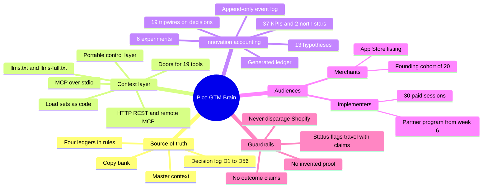

The repository was built with the [Ali GTM Brain skill](https://github.com/alielshenawy1/Ali-GTM-Brain-Skill), installed in `.claude/skills/` so any agent can keep operating it with the same method: **BUILD**, **UPDATE**, **OPERATE**. The source material is the full Pico GTM build in [PicoFindsGTMBuild](https://github.com/Saasrelaunchdev/PicoFindsGTMBuild): nine dashboards per audience, two lead magnets, two deck outlines, a 56-entry decision log, and a dated research pass of 18 files, copied into `sources/` for provenance.

---

## 2. Quickstart and tool matrix

Requirements: Python 3.9 or newer. No packages, no network, no build step.

```bash
git clone https://github.com/Saasrelaunchdev/PicoGTMBrain.git && cd PicoGTMBrain
```

```bash
python3 tools/brain.py context cold-email --format cat     # the exact files an agent needs, concatenated
```

```bash
python3 tools/brain.py lint draft.md                       # claims, status, channels, mechanics
```

```bash
python3 tools/brain.py signal --type OBJECTION --source "founding call" --verbatim "Does it hand off to my team?" --tags handoff-request
```

```bash
python3 tools/brain.py metrics && python3 tools/brain.py tripwires
```

```bash
python3 tools/brain.py audit && python3 -m unittest discover -s tools/tests
```

`make build`, `make check`, `make audit`, `make test`, `make mcp`, and `make http` wrap the same commands.

### Tool matrix

Tools that read files load the brain as soon as the repository is open. Rows that name per-user settings, a host, or a paste need that one step.

| Tool | Reads automatically | Slash commands | MCP |
|---|---|---|---|
| Claude Code | `CLAUDE.md`, the skills in `.claude/skills/` | `.claude/commands/`: `/write`, `/log-signal`, `/log-event`, `/weekly-review`, `/snapshot`, `/amend`, `/audit` | `.mcp.json` |
| OpenAI Codex CLI | `AGENTS.md` | `adapters/codex/prompts/`, copied to `~/.codex/prompts/`, as `/prompts:pico-write` and the rest | `adapters/codex/config.toml`, merged into `~/.codex/config.toml` |
| Cursor | `.cursor/rules/pico-gtm-brain.mdc`, `AGENTS.md` | `.cursor/commands/`, as `/pico-write` and the rest | `.cursor/mcp.json` |
| Windsurf | `.windsurf/rules/pico-gtm-brain.md` | `.windsurf/workflows/`, as `/pico-write` and the rest | Windsurf MCP settings |
| GitHub Copilot in VS Code | `.github/copilot-instructions.md` | `.github/prompts/`, as `/pico-write` and the rest | `.vscode/mcp.json`, agent mode |
| Gemini CLI | `GEMINI.md` and `AGENTS.md`, named in `.gemini/settings.json` | `.gemini/commands/pico/`, as `/pico:write` and the rest | `.gemini/settings.json` |
| opencode | `AGENTS.md` | `.opencode/command/`, as `/pico-write` and the rest | opencode config |
| Cline | `.clinerules/pico-gtm-brain.md` | none | Cline MCP settings |
| Roo Code | `.roo/rules/pico-gtm-brain.md` | none | Roo MCP settings |
| Continue | `.continue/rules/pico-gtm-brain.md` | none | Continue config |
| Kiro | `.kiro/steering/pico-gtm-brain.md` | none | Kiro MCP config |
| Amazon Q Developer | `.amazonq/rules/pico-gtm-brain.md` | none | Q MCP config |
| JetBrains Junie | `.junie/guidelines.md` | none | IDE MCP settings |
| JetBrains AI Assistant | `.aiassistant/rules/pico-gtm-brain.md`, rule type Always | none | IDE MCP settings |
| Trae | `.trae/rules/project_rules.md` | none | Trae MCP settings |
| OpenHands | `.openhands/microagents/repo.md` | none | Runs the CLI in its sandbox |
| Goose | `.goosehints` | none | A stdio extension |
| Aider | `.aider.conf.yml` loads `AGENTS.md`, the four rules files, and the QA checklist read-only | none | none |
| Zed, Jules, Amp | `AGENTS.md` | none | Zed context servers |
| Claude Desktop | nothing | The four MCP prompts | `adapters/claude-desktop/claude_desktop_config.json` |
| Custom connectors that take a remote MCP URL, in Claude and ChatGPT | nothing | The four MCP prompts | `https://<host>/mcp/<token>` on `tools/http_server.py` |
| ChatGPT custom GPTs | nothing | none | Actions from `adapters/http/openapi.json` to read and `adapters/http/github-dispatch.openapi.json` to write, with `llms-full.txt` as knowledge |
| ChatGPT, Claude.ai Projects, Gemini Gems, Grok, Perplexity | nothing | none | Paste `adapters/portable-control-layer.md`, attach `llms-full.txt` |
| n8n, Zapier, Make, Dify, Flowise | nothing | none | REST `/v1` to read, `repository_dispatch` to write |
| LangGraph, CrewAI, OpenAI Agents SDK, Mastra, scripts | nothing | none | An MCP client adapter, or `brain.py context --format json` |
| The Pico product repository | `adapters/consuming-repo/` blocks | none | `brain-lint.yml` lints copy in CI |

Per-user MCP settings take `python3 /absolute/path/to/PicoGTMBrain/tools/mcp_server.py`. `CLAUDE.md` and `AGENTS.md` are written by hand. Every other rule file is rendered from `adapters/door.md`, and every command outside Claude Code from `.claude/commands/`, see [section 7](#how-the-doors-are-rendered).

---

## 3. Architecture

The brain is a layered system with one writer path. Agents and humans read through the interfaces at the top, write only through the state and innovation layers, and every customer-facing word is derived from the control and reference layers.

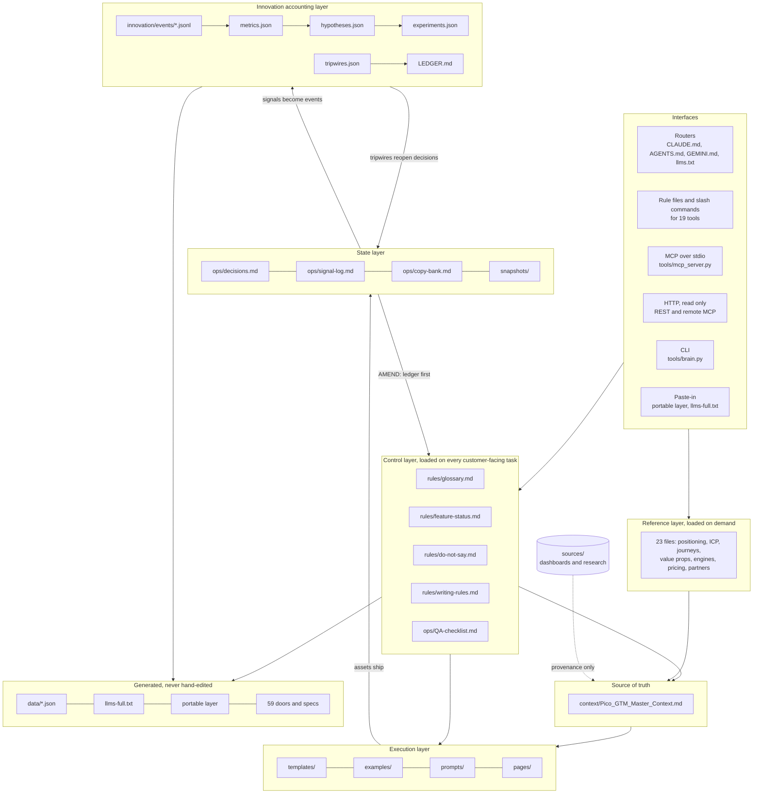

**Precedence, top wins:**

1. `rules/` ledgers for anything they govern: names, status, claims, mechanics. They change first in every amendment.
2. `context/Pico_GTM_Master_Context.md` for strategy. Authoritative when it and a reference file disagree.
3. `ops/decisions.md` for anything decided, with its reopen trigger.
4. `reference/` files.
5. `templates/`, `examples/`, `prompts/`.
6. Generated files: `data/`, `llms-full.txt`, the portable layer, `innovation/LEDGER.md`, every rendered door. They are projections and lose every argument.
7. `sources/`, which are evidence, not instructions.

Among routers, `CLAUDE.md` wins.

### The build graph

Every generated artifact is a pure function of the hand-edited sources and the event log, so CI can prove nothing drifted. `build` is idempotent: a second run changes nothing.

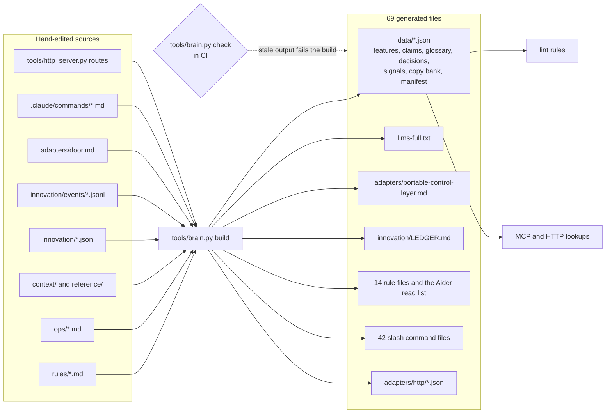

---

## 4. Repository map

| Path | Layer | Loaded when | Written by |
|---|---|---|---|
| `CLAUDE.md`, `AGENTS.md` | Router | Every session, automatically | Humans, rarely |
| `GEMINI.md` | Router, rendered | Gemini CLI sessions | `brain.py build` |
| `llms.txt`, `llms-full.txt` | Index, full text | When an agent decides what to open, or ingests one file | `llms.txt` by hand, `llms-full.txt` generated |
| `context/Pico_GTM_Master_Context.md` | Source of truth | Strategy questions, any new agent | AMEND only |
| `rules/` | Control | Every customer-facing task | AMEND only |
| `reference/` | Reference | By task, see the load policy | PATCH or AMEND |
| `templates/`, `examples/`, `prompts/` | Execution | Producing an asset | PATCH |
| `pages/` | Execution | Updating a shipped asset | After shipping |
| `ops/` | State | Signals, decisions, copy, QA | CLI, MCP, humans |
| `snapshots/` | State | Monthly, then quarterly | `brain.py snapshot`, then humans |
| `innovation/` | Innovation accounting | Weekly review, experiments | CLI, MCP, the ingest workflow |
| `schemas/` | Machine | Validation | Humans, rarely |
| `data/` | Machine, generated | Lint, MCP, HTTP, integrations | `brain.py build` |
| `tools/brain.py`, `tools/mcp_server.py`, `tools/http_server.py`, `tools/tests/` | Machine | Always available | Humans |
| `Dockerfile`, `.dockerignore`, `.gitattributes`, `Makefile` | Machine | Hosting, merges, shortcuts | Humans |
| `adapters/door.md`, `.claude/commands/` | Door sources | Never loaded directly by a tool except Claude Code | Humans |
| `.cursor/`, `.windsurf/`, `.github/`, `.vscode/`, `.gemini/`, `.clinerules/`, `.roo/`, `.continue/`, `.kiro/`, `.amazonq/`, `.junie/`, `.aiassistant/`, `.trae/`, `.openhands/`, `.opencode/`, `.goosehints`, `.aider.conf.yml`, `.mcp.json` | Doors, mostly rendered | Per tool | `brain.py build`, MCP configs by hand |
| `adapters/` | Doors for tools configured per machine, the portable layer, the HTTP specs | Per tool | Humans and `brain.py build` |
| `.claude/skills/` | The installed method | BUILD, UPDATE, OPERATE | The installer |
| `sources/` | Provenance | When a ledger line is questioned | Never edited |

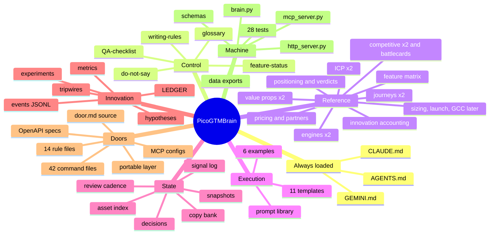

---

## 5. Data model

The ledgers are Markdown for people and agents, and every one of them has a typed projection for code. The innovation layer is JSON from the start.

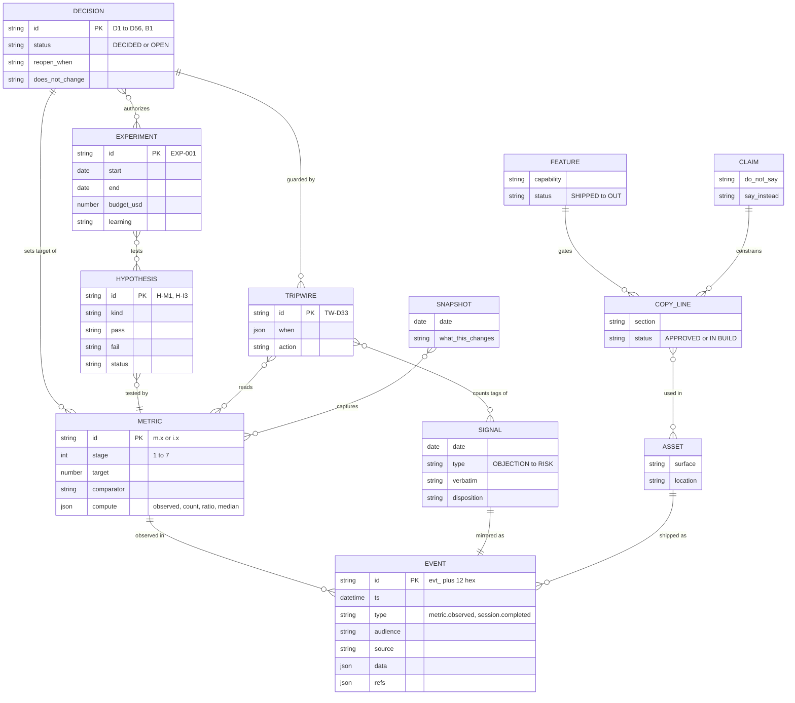

| Schema | Validates | Used by |
|---|---|---|
| `schemas/event.schema.json` | Every line of `innovation/events/*.jsonl` | `brain.py event`, `observe`, `signal`, the MCP write tools, the ingest workflow, CI |
| `schemas/signal.schema.json` | Signal log entries | `brain.py signal`, `brain_log_signal` |
| `schemas/metrics.schema.json` | `innovation/metrics.json` | `brain.py validate`, `metrics` |
| `schemas/hypotheses.schema.json` | `innovation/hypotheses.json` | `validate`, `ledger` |
| `schemas/experiments.schema.json` | `innovation/experiments.json` | `validate`, `ledger` |
| `schemas/tripwires.schema.json` | `innovation/tripwires.json` | `validate`, `tripwires` |
| `schemas/export.schema.json` | Every file in `data/` | `build`, tests |

On 2026-11-05 the projections hold 49 capabilities with status flags, 33 forbidden claims with replacements, 32 glossary terms, 19 dated decision entries covering D1 to D56 and B1, 9 signals, and 13 events. Identifiers are stable and cross-referenced everywhere: decisions `D1` to `D56` and `B1`, hypotheses `H-M*` and `H-I*`, experiments `EXP-*`, tripwires `TW-D*`, metrics `m.*` and `i.*`, events `evt_*`. Cite them in commit messages, signals, and events.

---

## 6. Use case A: the source of truth

**Problem it solves.** Pico's strategy came out of a build with dozens of documents, a walkthrough, a Google folder, and a decision log. Without one governed home, every agent and every contractor re-derives positioning, gets status wrong, and repeats claims the strategy already narrowed. The brain makes one place authoritative and every other copy a projection of it.

**Properties, in engineering terms:**

- **Single writer path.** Ledgers change only through the AMEND procedure, in a fixed order: `rules/`, then the master context with a version bump, then a dated decision entry, then the copy, then `build`. Copy that leads a ledger is a bug.
- **Append-only history.** Decisions are never rewritten, only superseded by a newer dated entry with an explicit "what this does not change". Events are never edited, only corrected by a new event with `refs.corrects`.
- **Typed projections.** `data/*.json` are generated from the Markdown, so code never parses prose and the prose never drifts from the data. CI proves it with `brain.py check`.
- **Status as a first-class field.** Every capability carries `SHIPPED`, `PARTIAL`, `IN BUILD`, `ROADMAP`, or `OUT`, and the linter refuses copy that writes an unshipped one in the present tense.
- **Closed proof set.** The proof log is empty on purpose. Anything outside it is fabrication, and the linter treats ratings, counts, and testimonials as errors.

### Which file wins

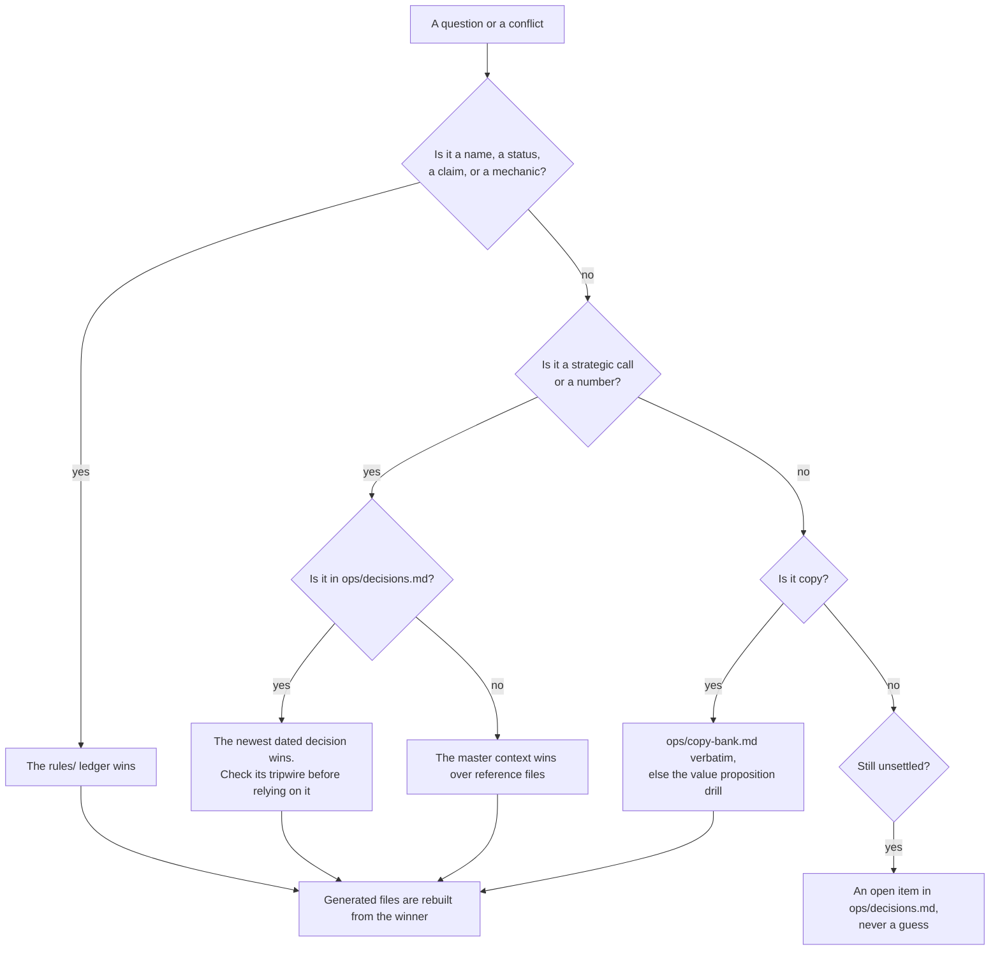

### The amendment procedure

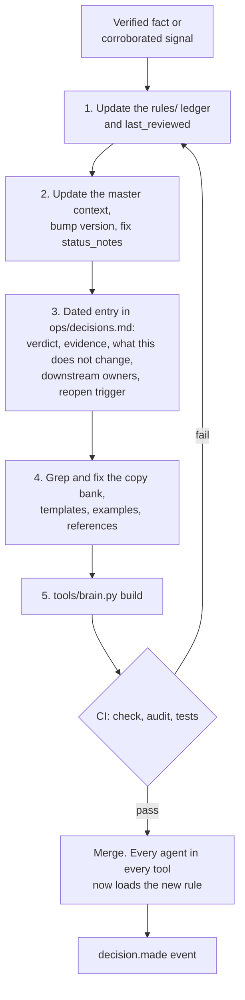

### Capability status lifecycle

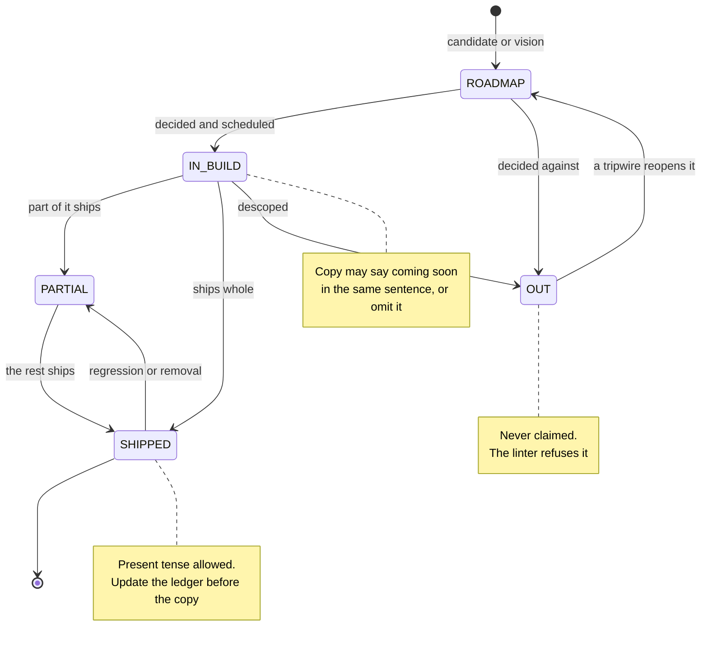

### What leads a message: the feature matrix

`reference/feature-matrix.md` scores every row on demand and competitiveness from -20 to +20 and sorts it into Hero, Differentiator, Commodity, or Table Stakes. The charts plot the rows it publishes scores for, rescaled to 0 to 1, one chart per audience. A candidate in any quadrant is a roadmap finding, never a claim.

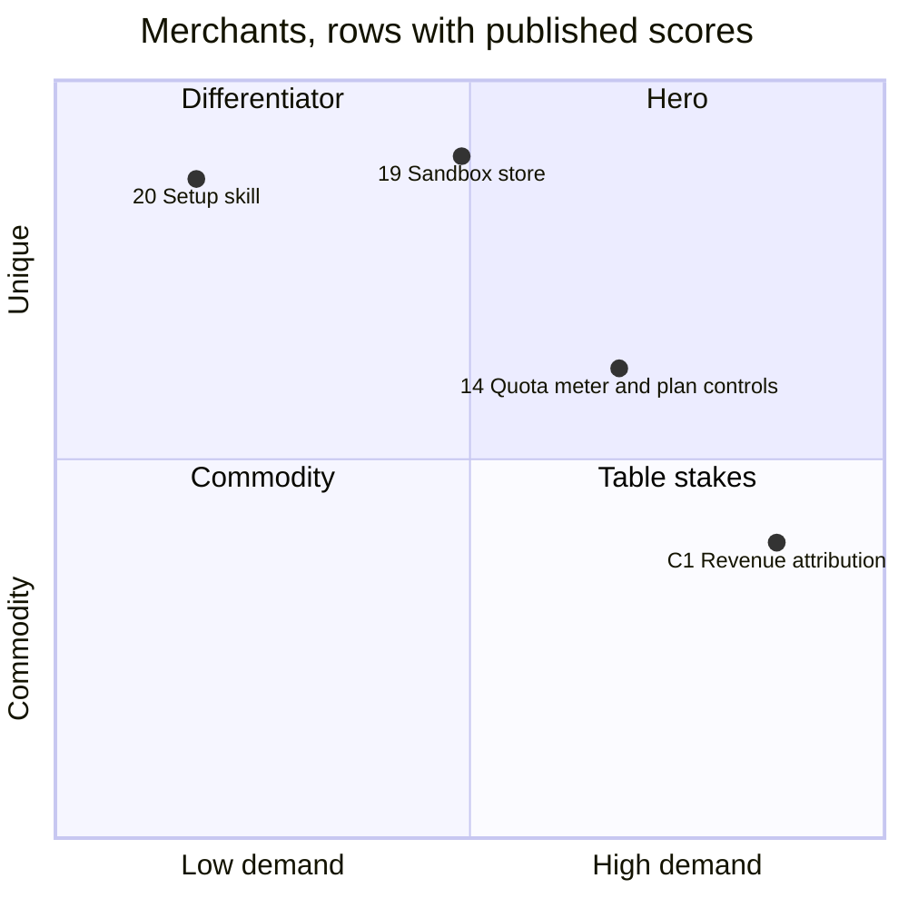

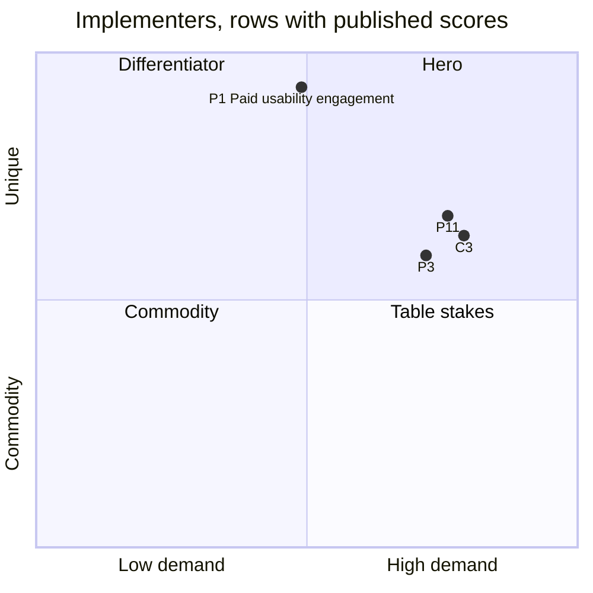

Row IDs are the matrix's own: C1 revenue attribution and C3 the multi-store workspace are candidates, P1 is the paid usability engagement, P3 case studies with client stores, and P11 pay for managing stores.

What it settles: merchant differentiators sit where US demand is low today, so copy leads with the demand driver, not the differentiator. The quota meter becomes the Hero line only once the conversation definition and the no-overage rule ship. For implementers, the paid engagement is the differentiator that pays before any referral, and every Hero row is still unbuilt.

### Predicted questions and where the answer lives

| Question someone will ask | Answer lives in | Fastest call |
|---|---|---|
| Can the listing say "real-time inventory"? | `rules/do-not-say.md`: no, "Stock as of your last catalog sync" | `brain.py lookup claim "real-time"` |
| Is the Scale plan live? | `rules/feature-status.md`: IN BUILD | `brain.py lookup feature scale` |
| What exactly counts as a conversation? | D24 in `ops/decisions.md` | `brain.py lookup decision D24` |
| Do we pay implementers before they refer anyone? | `reference/partner-program.md`: $150 a session, then 25% for 24 months once the partner page is live in week 6 | MCP `brain_read` on `reference/partner-program.md` |
| Can we cold-email a UK freelancer? | D48: no, UK companies and LLPs only, after day 90 | `brain.py lookup decision D48` |
| Why is the listing in the Chat category? | D42 | `brain.py lookup decision listing` |
| What did we decide about human handoff, and what would change it? | D12, guarded by `TW-D12` | `brain.py tripwires` |
| How many US stores fit Level 1? | `reference/market-sizing.md`: about 54,300 after the catalog cutoff, one tracker | `brain.py search 54,300` |
| What is the one-line positioning for implementers? | `ops/copy-bank.md`: "Paid to test it. Credited when it works." | `brain.py search "Paid to test it"` |

### Sequence: an engineer edits product copy in the Pico app repository

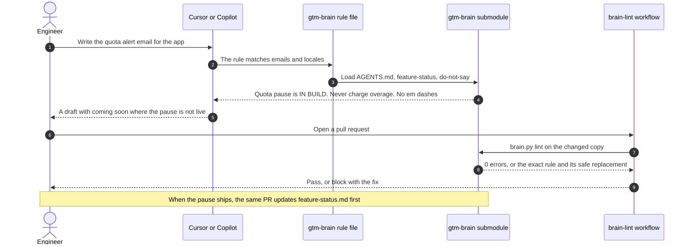

---

## 7. Use case B: the context layer

**Problem it solves.** The founder and the team will use many AI tools: Claude Code and Codex in the terminal, Cursor in the editor, ChatGPT or Claude.ai for drafts, Gemini, agent frameworks, automations. Each starts with zero knowledge of Pico. The context layer gives every tool the same governed context, sized to the task, through whichever door the tool supports.

### How context is assembled

The load policy is code: `TASKS` in `tools/brain.py` maps 21 tasks to ordered file sets. Every customer-facing set starts with the router and the control layer, then adds the audience's references, the channel engine, the template, and the matching example. Fixed-audience tasks refuse the other audience, so blending is impossible by construction: `context cold-email --audience merchants` exits with an error.

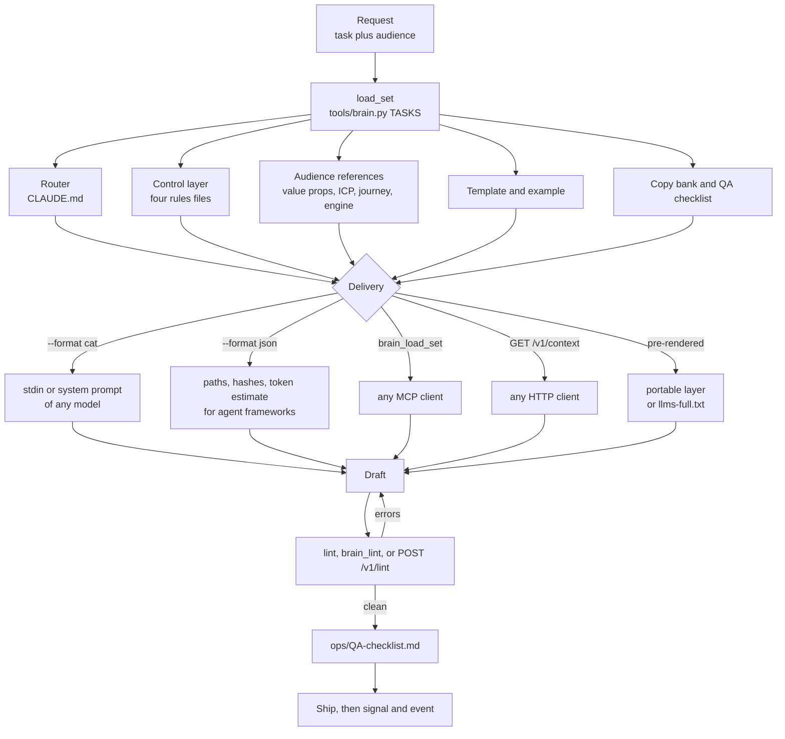

**Token budgets, measured on this repository** (bytes divided by 4):

| Load | Files | Approximate tokens |
|---|---|---|
| Router only, `session` | `CLAUDE.md` | 800 |
| Control layer | router plus four rules files | 5,700 |
| `job-post`, `partner-page`, `lifecycle-email` | 9 to 11 | 8,900 to 9,900 |
| `cold-email`, `app-store-listing` | 11 | 10,400 to 11,000 |
| `landing-page` for merchants, the largest asset task | 13 | 13,500 |
| `amend`, the largest task | 8 | 16,300 |
| Portable control layer | one generated file | 3,000 |
| Everything | `llms-full.txt` | 43,000 |

Check any set precisely: `python3 tools/brain.py context app-store-listing --format json` returns paths, byte counts, SHA-256 hashes, and the estimate. The sets are stable per task, so they cache well as a system prompt prefix.

### The doors, by capability

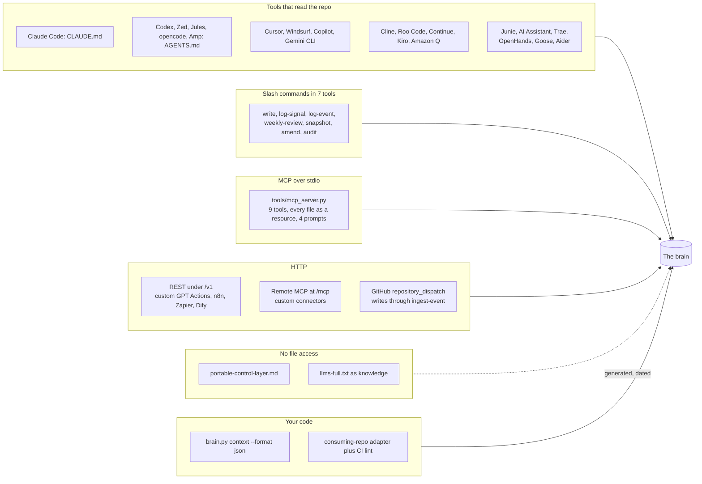

### How the doors are rendered

A door that restates a rule drifts the day the rule changes, and a stale guardrail still carries authority. So no door is written by hand: `adapters/door.md` holds the one pointer, `.claude/commands/` holds the seven commands, and `build` renders them into each tool's format, frontmatter, argument syntax, and command names. The installer's marked blocks in `GEMINI.md` and `.github/copilot-instructions.md` are kept across builds.

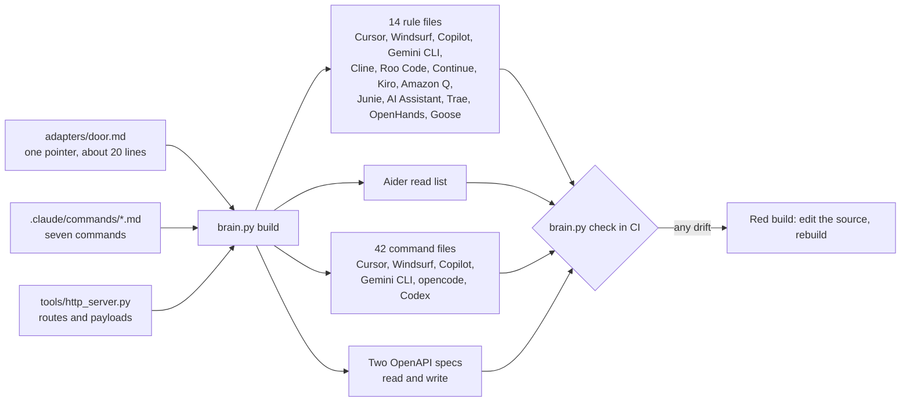

| Tool | Command file | Invoked as | Arguments |
|---|---|---|---|
| Claude Code | `.claude/commands/write.md`, the source | `/write` | `$ARGUMENTS` |
| Codex CLI | `adapters/codex/prompts/pico-write.md` | `/prompts:pico-write` | `$ARGUMENTS` |
| Cursor | `.cursor/commands/pico-write.md` | `/pico-write` | The text after the command |
| Windsurf | `.windsurf/workflows/pico-write.md` | `/pico-write` | The text after the command |
| Copilot | `.github/prompts/pico-write.prompt.md` | `/pico-write` | An input variable |
| Gemini CLI | `.gemini/commands/pico/write.toml` | `/pico:write` | The args placeholder |
| opencode | `.opencode/command/pico-write.md` | `/pico-write` | `$ARGUMENTS` |

### MCP over stdio

`tools/mcp_server.py` speaks newline-delimited JSON-RPC 2.0 and negotiates protocol versions `2025-06-18`, `2025-03-26`, and `2024-11-05`. It exposes 9 tools, every brain file as a `brain:///<path>` resource, and 4 prompts. `PICO_BRAIN_READONLY=1` hides the two write tools.

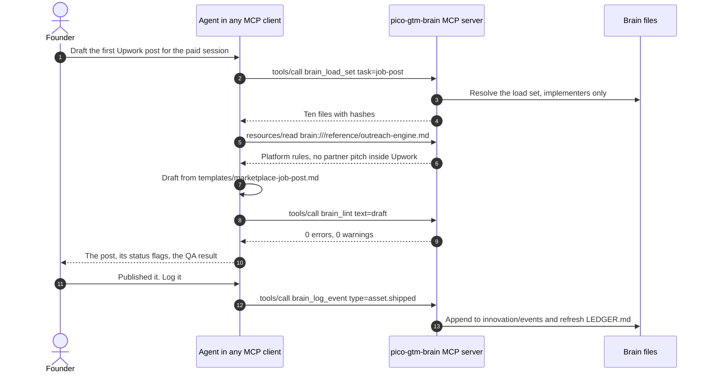

Claude Code reads `.mcp.json` at the repository root. For tools configured per machine:

```json
{
  "mcpServers": {
    "pico-gtm-brain": {
      "command": "python3",
      "args": ["/ABSOLUTE/PATH/TO/PicoGTMBrain/tools/mcp_server.py"],
      "env": { "PICO_BRAIN_READONLY": "1" }
    }
  }
}
```

```toml
# ~/.codex/config.toml
[mcp_servers.pico-gtm-brain]
command = "python3"
args = ["/ABSOLUTE/PATH/TO/PicoGTMBrain/tools/mcp_server.py"]
```

### HTTP: REST and remote MCP

`tools/http_server.py` serves the same brain to tools that cannot start a local process. REST lives under `/v1` and is described by `adapters/http/openapi.json`, generated from the server's own route table. Remote MCP lives at `/mcp`, speaking MCP Streamable HTTP with JSON responses and reusing the stdio server's dispatcher. Both are read only by design: a hosted copy's disk is disposable, so durable writes go through git, and `adapters/http/github-dispatch.openapi.json` describes that write path for HTTP-only tools.

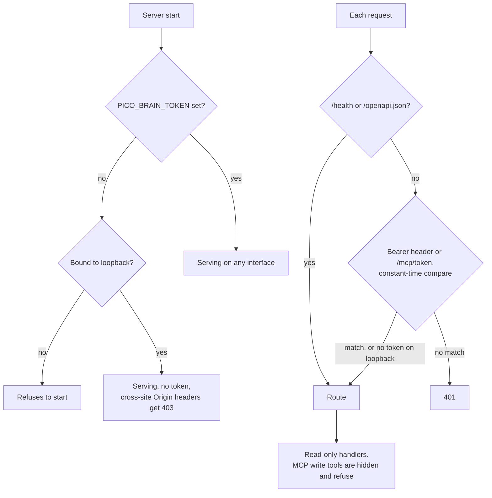

Run it locally:

```bash
python3 tools/http_server.py &
curl -s "http://127.0.0.1:8765/v1/context/cold-email?format=cat" | head -20
curl -s -X POST http://127.0.0.1:8765/v1/lint -H "Content-Type: application/json" -d '{"text": "Pico boosts conversion by 20%."}'
curl -s -X POST http://127.0.0.1:8765/mcp -H "Content-Type: application/json" -d '{"jsonrpc": "2.0", "id": 1, "method": "tools/list"}'
```

Host it, behind TLS from Cloud Run, Fly.io, Render, or a reverse proxy. The server reads `PORT` when the host sets one:

```bash
docker build -t pico-gtm-brain . && docker run -p 8765:8765 -e PICO_BRAIN_TOKEN="$(openssl rand -hex 32)" pico-gtm-brain
```

Wire a custom GPT in three steps: paste `adapters/portable-control-layer.md` as its instructions and upload `llms-full.txt` as knowledge, add an Action from `adapters/http/openapi.json` with your host as the server and the token as a Bearer API key, then add an Action from `adapters/http/github-dispatch.openapi.json` with a fine-grained GitHub token for this repository only, with Contents read and write. A custom connector that takes a remote MCP URL gets `https://<host>/mcp/<token>`; the server redacts the token from its logs.

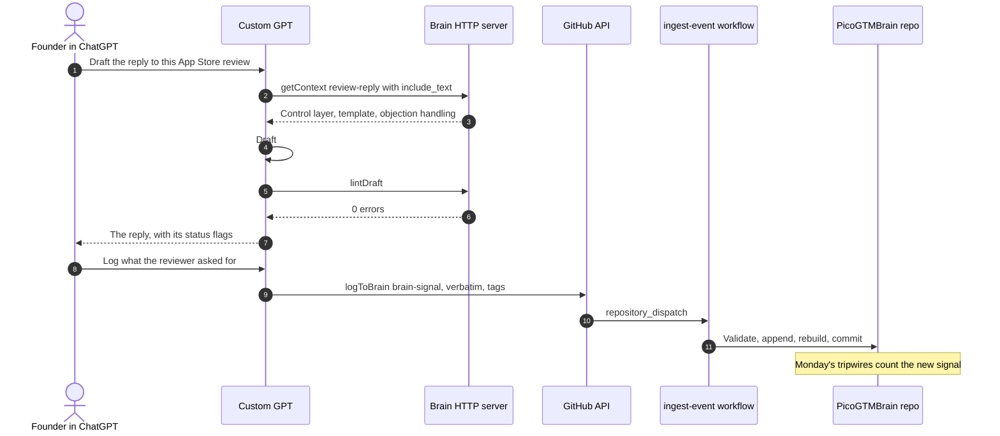

### Your own code

A shell pipeline into any model command line tool, here Simon Willison's `llm`:

```bash
llm -s "$(python3 tools/brain.py context cold-email --format cat)" \
  "Write a first email to a Shopify freelancer in Austin who builds for outdoor brands." > draft.md
python3 tools/brain.py lint draft.md
```

Headless agents in this checkout load their router on their own:

```bash
claude -p "Write a first cold email to a Shopify freelancer in Austin who builds for outdoor brands. Lint it before you answer."
```

An agent node with the Anthropic Python SDK. It reads the model ID from `PICO_BRAIN_MODEL`, so the example never pins a model that later retires. It checks for a refusal before reading the text, and it takes the text block by type, because current models can return a thinking block first. On models that offer server-side fallback, call `client.beta.messages.create` with `betas=["server-side-fallback-2026-07-01"]` and `fallbacks="default"`, and a declined request is re-run on Anthropic's recommended model:

```python
import json
import os
import subprocess

import anthropic


def brain(*args, stdin=None):
    """Run the brain CLI from the repository root and return its stdout."""
    return subprocess.run(["python3", "tools/brain.py", *args], input=stdin,
                          capture_output=True, text=True).stdout


client = anthropic.Anthropic()
response = client.messages.create(
    model=os.environ["PICO_BRAIN_MODEL"],  # a model ID from Anthropic's models list
    max_tokens=16000,
    system=brain("context", "app-store-listing", "--format", "cat"),
    messages=[{"role": "user", "content": "Draft the App Store listing introduction and details."}],
)
if response.stop_reason == "refusal":
    raise SystemExit(f"declined: {getattr(response, 'stop_details', None)}")
draft = next((b.text for b in response.content if b.type == "text"), "")
errors = [f for f in json.loads(brain("lint", "-", "--json", stdin=draft)) if f["severity"] == "error"]
# Send the errors back with the draft until the list is empty, then walk ops/QA-checklist.md.
```

The same two calls, a system prompt from `context` and a `lint` pass, work with any model provider.

The Pico product repository mounts the brain as a submodule and lints copy in CI:

```bash
git submodule add https://github.com/Saasrelaunchdev/PicoGTMBrain.git gtm-brain
cat gtm-brain/adapters/consuming-repo/AGENTS.block.md >> AGENTS.md
mkdir -p .github/workflows && cp gtm-brain/adapters/consuming-repo/brain-lint.yml .github/workflows/
```

### Predicted context-layer jobs for Pico

| Week | Job | Task in the load policy | Audience |
|---|---|---|---|
| 1 | Align picofinds.com with the US-first plan, replace the three broad lines | `landing-page` | merchants |
| 1 | Submit the "Pico AI Shopping Assistant" listing | `app-store-listing` | merchants |
| 1 | First Upwork post, first emails, first LinkedIn notes | `job-post`, `cold-email`, `linkedin` | implementers |
| 1 | Technical one-pager once the Dawn speed test is measured | `one-pager` | each, separately |
| 2 | Sync failure email copy | `lifecycle-email` | merchants |
| 3 | Merchant scorecard landing page and emails | `landing-page`, `lifecycle-email` | merchants |
| 4 | First insight and weekly summary emails before the cohort opens | `lifecycle-email` | merchants |
| 4 onward | Founding cohort onboarding calls and follow-ups | `sales-call` | merchants |
| 6 | Partner page, invitation messages, implementer scorecard | `partner-page`, `linkedin`, `landing-page` | implementers |
| Ongoing | App Store review replies within 2 business days | `review-reply` | merchants |
| Ongoing | Catalog guides and comparison pages for AI answer engines | `seo-article` | merchants |
| Monthly | Investor or advisor update | `investor-update` | internal |
| Any time | A designer, video contractor, or agency joins | paste the portable control layer | either |

---

## 8. Use case C: the innovation accounting layer

**Problem it solves.** Pico is pre-launch, so the only honest measure of progress is validated learning: which assumptions survive contact with real merchants and implementers, and how fast. Activity happens in many places: the Partner Dashboard, Shopify Billing, ScoreApp, Upwork, Fiverr, the email tool, calls, reviews. The innovation accounting layer receives all of it as typed events, computes every KPI against the plan, tests the hypotheses behind the plan, and fires tripwires when a decision's own reopen condition is met.

### The snowball

Each turn of the loop leaves the brain sharper. Verbatim customer language accumulates in the copy bank, every closed experiment leaves a learning, every challenged claim tightens the claim ledger for good, and every amendment improves every later asset in every tool at once, because all 19 tools read the same ledgers.

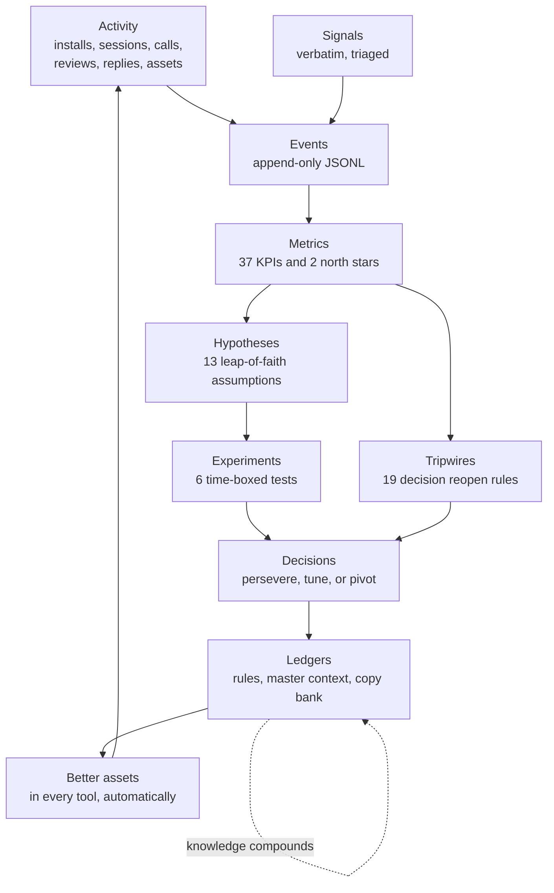

### Sequence: the Monday loop

Values in this section's examples are illustrative. Real values enter only through `observe` and `event`, each with its source.

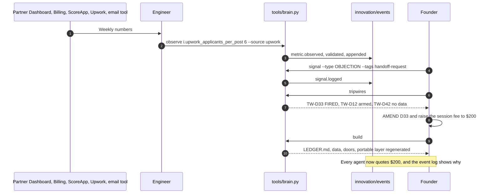

### Signal triage

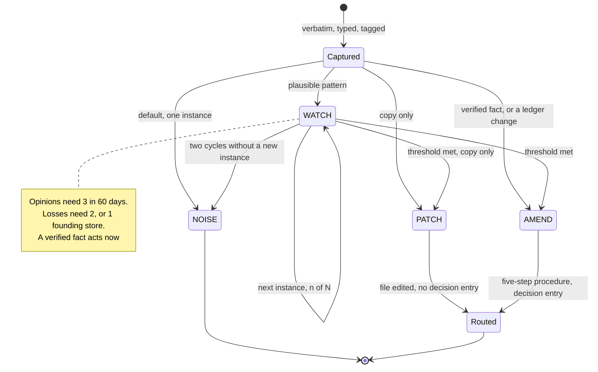

### Experiment lifecycle

```mermaid
stateDiagram-v2
    [*] --> planned
    planned --> running: experiment.started event
    running --> closed: end date, result, learning
    running --> abandoned: invalid design, logged with reason
    closed --> [*]: decision taken, hypothesis status updated
    abandoned --> [*]
```

### The metric tree

Every target below is from `innovation/metrics.json`, which carries the review point for each.

```mermaid
flowchart LR
    NS1(["Merchant north star<br/>stores that made a catalog fix in 30 days"])
    NS2(["Implementer north star<br/>client stores installed by implementers"])
    NS1 --> M1["1. Scorecard to sandbox, 25%"]
    NS1 --> M2["2. Listing visit to install, 3%"]
    NS1 --> M3["3. Sandbox visit to install, 10%"]
    NS1 --> M4["4. Widget seen in 24 hours, 65%<br/>paid plan by day 30, 15%"]
    NS1 --> M5["5. 3 catalog fixes per founding store"]
    NS1 --> M6["6. 10 unincentivized reviews<br/>20 founding stores"]
    NS1 --> M7["7. Uninstalls under 15% a month"]
    NS2 --> I1["1. Cold email replies 5%<br/>LinkedIn acceptance 30%"]
    NS2 --> I2["2. 10 qualified applicants per Upwork post"]
    NS2 --> I4["4. 30 sessions, setup under 30 minutes"]
    NS2 --> I5["5. 15 interviews"]
    NS2 --> I6["6. 3 case study permissions<br/>15 partner sign-ups"]
    NS2 --> I7["7. 10 implementers on a second client store<br/>every payout on the 15th"]
```

A count with no evidence reports `no data`, never `below target`, so the pre-launch ledger does not read as failure.

### Hypotheses, experiments, and tripwires

| Hypothesis | Metric and pass line | Experiment | On failure |
|---|---|---|---|
| H-M2: a Shopper Words Test listing converts 3% before reviews | `m.listing_to_install` at least 3% at day 30 | EXP-002 listing v1 | `TW-D42` below 2%: rework the listing, screenshots first |
| H-M3: the checklist gets 65% of installs to widget seen in 24 hours | `m.widget_seen_24h` after 50 installs | EXP-003 founding cohort | Tune the checklist prompts, route installs to implementers |
| H-M4: a capped quota keeps billing out of uninstall reasons | `m.pause_uninstall_share` at most 20% | EXP-006 quota pause | `TW-D25`: revisit the quota behavior, never overage without a decision |
| H-I1: paid work gets a 5% cold reply rate | `i.cold_email_reply_rate` at day 30 | EXP-001 session cohort | Shift sessions to the channel with the best completion rate (D37) |
| H-I3: a $150 Upwork post draws 10 qualified applicants | `i.upwork_applicants_per_post` | EXP-001 | `TW-D33`: raise the fee to $200 |
| H-I4: half of participants join the partner program | `i.partner_signups`, 15 by day 90 | EXP-005 partner launch | Revisit the terms and the invitation route |
| H-I7: half accept the $75 interview | `i.interview_acceptance` | EXP-001 | `TW-D34`: rethink the interview incentive |

All 13 hypotheses, 6 experiments, and 19 tripwires are in `innovation/`, and their live state is in `innovation/LEDGER.md`. Tripwire conditions compose: `{"metric", "op", "value"}`, a tagged-signal count in a window, an event count in a window, and `all` or `any` over those. `TW-D11`, the GCC trigger, is `all` of 5 `gcc-inbound` signals in 90 days and 20 founding stores.

### Events, by example

Illustrative payloads, not real events. The log holds only real ones, 13 on 2026-11-05: the GTM build, its research signals, the brain's creation, and its live test.

```json
{"id":"evt_3b1f0c9a2d4e","ts":"2026-11-18T15:04:00Z","type":"session.completed","audience":"implementers","source":"upwork","data":{"channel":"upwork","setup_minutes":24,"theme":"Dawn","client_store":false},"refs":{"experiments":["EXP-001"],"hypotheses":["H-I2"]}}
{"id":"evt_9c2e71aa0b13","ts":"2026-12-02T09:30:00Z","type":"cohort.joined","audience":"merchants","source":"founding cohort list","data":{"category":"outdoor","plan":"Growth"},"refs":{"decisions":["D30"]}}
{"id":"evt_51d7e0f4c8b2","ts":"2026-12-15T11:00:00Z","type":"metric.observed","audience":"merchants","source":"Partner Dashboard","data":{"metric":"m.listing_to_install","value":0.031,"period":"2026-12-01..2026-12-14"},"refs":{"metrics":["m.listing_to_install"]}}
```

Events arrive through four paths, all validated against `schemas/event.schema.json`:

1. `python3 tools/brain.py event <type> --data '{...}'` and `python3 tools/brain.py observe <metric> <value>`.
2. The MCP tools `brain_log_event` and `brain_log_signal`, from any agent with a stdio server.
3. The `ingest-event` GitHub workflow, triggered by `repository_dispatch` from Zapier, n8n, Make, a Shopify webhook relay for `app/uninstalled` and `app_subscriptions/update`, or a custom GPT Action built from `adapters/http/github-dispatch.openapi.json`.
4. A pull request that appends to `innovation/events/YYYY-MM.jsonl`, reviewed like code. `.gitattributes` merges the event log with `merge=union`, so concurrent appends never conflict.

```bash
curl -X POST -H "Authorization: Bearer $GITHUB_TOKEN" -H "Accept: application/vnd.github+json" \
  https://api.github.com/repos/Saasrelaunchdev/PicoGTMBrain/dispatches \
  -d '{"event_type":"brain-event","client_payload":{"type":"session.completed","audience":"implementers","source":"upwork","data":{"channel":"upwork","setup_minutes":24}}}'
```

### Learning milestones on the calendar

```mermaid
timeline
    title Baseline, tune, pivot or persevere
    section Baseline
        Week 1 from 2026-11-09 : Listing submitted : First Upwork post and emails : Speed test on Dawn
        Week 2 : First paid sessions : Permission forms ready
        Week 3 : Listing live target : Merchant scorecard live
    section Tune
        Week 4 from 2026-11-30 : Founding cohort opens 2026-12-01 : First insight email live
        Week 5 : Counsel reviews the partner terms
        Week 6 from 2026-12-14 : Partner page live : Proof capture point live
        Week 9 : 30 sessions complete : First case study permission requests
    section Pivot or persevere
        Week 12 from 2027-01-25 : Day 60 review
        Week 13 from 2027-02-01 : Day 90 review : Next spend block released or not
```

```mermaid
gantt
    title Launch build list and experiment windows
    dateFormat YYYY-MM-DD
    axisFormat %b %d
    section Calendar
    Black Friday to Cyber Monday theme freeze :crit, f1, 2026-11-27, 4d
    section Build list
    Inventory webhook                        :b1, 2026-11-09, 7d
    Sync failure email                       :b2, 2026-11-16, 7d
    First insight email and weekly summary   :b3, 2026-11-30, 7d
    Partner ledger payouts and proof capture :b4, 2026-12-14, 7d
    Monthly usage summary                    :b5, 2026-12-28, 7d
    Words against the catalog check          :b6, 2027-01-11, 7d
    section Experiments
    EXP-001 paid session cohort of 30        :e1, 2026-11-09, 2027-01-08
    EXP-005 partner program launch           :e5, 2026-12-14, 2027-02-01
    EXP-004 merchant scorecard opens         :milestone, e4, 2026-11-23, 0d
    EXP-003 founding cohort opens            :milestone, e3, 2026-12-01, 0d
    section Reviews
    Counsel review of partner terms          :milestone, r1, 2026-12-07, 0d
    Day 60 review                            :milestone, r2, 2027-01-25, 0d
    Day 90 review                            :milestone, r3, 2027-02-01, 0d
```

EXP-002 starts when the listing goes live and EXP-006 when the quota pause ships. EXP-003 and EXP-004 close relative to the listing's go-live date, so the chart shows only their openings. `review_date()` resolves every anchor, `listing_live` included, the moment it is set in `innovation/metrics.json`.

---

## 9. Predicted use cases across the launch

Each playbook names its trigger, the brain operations, and what changes. They follow the launch calendar and the decision log, so the brain already holds the rule for each.

| # | Trigger | Brain operations | What changes |
|---|---|---|---|
| 1 | The listing is approved (D2) | Set `anchors.listing_live` in `innovation/metrics.json`. AMEND `rules/feature-status.md` to SHIPPED. Swap "Connect your store" for "Install free from the Shopify App Store" in `ops/copy-bank.md`. `build` | Every agent in every tool switches the call to action. Day 30, 60, and 90 review dates appear in the ledger |
| 2 | The first paid sessions finish | `session.completed` events with `setup_minutes`. Findings as LANGUAGE signals | `i.median_setup_minutes` and H-I2 start testing |
| 3 | An Upwork post draws 6 applicants | `observe i.upwork_applicants_per_post 6` | `TW-D33` fires. AMEND D33 to $200, `build`, and every job post quotes $200 |
| 4 | A founding store asks for human handoff | `signal --type OBJECTION --tags handoff-request` | `TW-D12` counts toward 5 in 120 days. Until then the honest answer stays in `reference/objection-handling.md` |
| 5 | The quota pause ships (D25) | AMEND feature-status to SHIPPED. Remove the `[IN BUILD]` tag from the pause line in the copy bank. `build` | "No surprise charges. Pico pauses before it bills you more." becomes usable everywhere at once, and the linter stops warning |
| 6 | A competitor ships a conversational zero-result report | COMPETITIVE signal, verified, AMEND | `reference/positioning-verdict.md` already says what to do: lead with the fix loop. Battlecards and the claim scoping drill update |
| 7 | A merchant and an implementer both permit a case study | `case_study.permission` event with `both_sides: true`. AMEND the proof log with exact wording, source, and permission | The open proof line in that copy drill is replaced. `i.case_study_permissions` moves |
| 8 | Five GCC stores ask in one quarter and the cohort is full | Signals tagged `gcc-inbound`, `m.founding_stores` at 20 | `TW-D11` fires. `reference/gcc-later.md` holds the plan and the one approved line |
| 9 | Month 6 pricing review | `observe m.yearly_share`, `observe m.model_cost_per_conversation` | `TW-D26` and `TW-D28` decide whether the yearly offer or the model changes before any price does |
| 10 | A contractor joins to make screenshots or video | Paste `adapters/portable-control-layer.md`. Point them at the demo rule | Nothing unshipped appears on screen as usable, and sandbox data is labeled |
| 11 | The engineer writes in-product strings | Consuming-repo adapter plus `brain-lint.yml` | Copy pull requests that contradict the status ledger fail CI with the safe replacement |
| 12 | An investor asks how the launch is going | `brain.py context investor-update --format cat` | An update built from the ledger and events only, every number traceable |
| 13 | A partner disputes attribution twice in a quarter | Signals tagged `attribution-dispute` | `TW-D38` fires: tighten deal registration |
| 14 | The founder drafts in ChatGPT on a phone | The custom GPT with both Actions | Drafts are linted against the live ledger, and signals land in the repo through the ingest workflow |
| 15 | Day 60 review | `brain.py metrics`, `tripwires`, `snapshot day-60` | A dated snapshot that ends in what this changes, including "No ledger change this period" when that is the honest answer |

```mermaid
flowchart TD
    I["Something happened"] --> Q1{"Is it a number<br/>from a dashboard?"}
    Q1 -->|"yes"| OB["brain.py observe metric value"]
    Q1 -->|"no"| Q2{"Is it something a person<br/>said or wrote?"}
    Q2 -->|"yes"| SG["brain.py signal, verbatim, tagged"]
    Q2 -->|"no"| Q3{"Did we ship, change,<br/>or decide something?"}
    Q3 -->|"shipped an asset"| EA["event asset.shipped, file in pages/"]
    Q3 -->|"status changed"| AM["AMEND, ledger first"]
    Q3 -->|"decided"| DE["decisions.md entry, decision.made event"]
    Q3 -->|"no"| EV2["event of the matching type"]
    OB --> TWS["tripwires and ledger refresh"]
    SG --> TWS
    EA --> TWS
    AM --> TWS
    DE --> TWS
    EV2 --> TWS
```

---

## 10. Interfaces reference

### CLI: `tools/brain.py`

| Command | Purpose | Example |
|---|---|---|
| `context` | Print the load set for a task, as `list`, `cat`, or `json` | `context partner-page --format json` |
| `lint` | Check a file or stdin against the control layer. Exit 1 on errors | `lint draft.md --audience merchants` |
| `lookup` | Query a ledger: `feature`, `claim`, `term`, `decision`, `metric` | `lookup decision D35` |
| `search` | Grep the brain, skipping rendered doors | `search "theme app embed"` |
| `signal` | Append to the signal log, mirror as an event, refresh generated files | `signal --type LOSS --source "cancel flow" --verbatim "..."` |
| `event` | Append a typed event, with `--decisions`, `--experiments`, and other refs | `event review.received --audience merchants --data '{"rating":5}'` |
| `observe` | Record a KPI value | `observe i.cold_email_reply_rate 0.061 --source "email tool"` |
| `metrics` | Every KPI against target and review point | `metrics --audience implementers` |
| `tripwires` | Evaluate every reopen condition. `--strict` exits 3 if any fired | `tripwires --json` |
| `ledger` | Regenerate `innovation/LEDGER.md` | `ledger` |
| `snapshot` | Scaffold a dated snapshot with current metrics | `snapshot month-1` |
| `export`, `build` | Regenerate `data/`, or all 69 generated files | `build` |
| `check` | Fail if anything generated is stale | `check` |
| `validate` | JSON Schema validation of the innovation layer and the logs | `validate` |
| `audit` | The vendored skill audit on a mirror without `.claude/skills`, plus schemas, freshness, and example lint | `audit` |

Lint rules, all derived from the ledgers: `mechanics.em-dash`, `mechanics.en-dash`, `mechanics.banned-word`, `mechanics.slop-word`, `claims.do-not-say` (every quoted phrase in `rules/do-not-say.md`, with its replacement), `claims.outcome`, `claims.comparison`, `claims.superlative`, `claims.count`, `status.unshipped`, `channel.platform`, `channel.gcc`, `audience.blend`.

### MCP: `tools/mcp_server.py`, and `/mcp` on the HTTP server

| Kind | Name | Notes |
|---|---|---|
| Tool | `brain_load_set` | Load set for a task, optionally with full text |
| Tool | `brain_read` | Any brain file, sandboxed to the repository |
| Tool | `brain_search` | Case-insensitive search |
| Tool | `brain_lint` | The CLI linter, returns findings with fixes |
| Tool | `brain_lookup` | Feature, claim, term, decision, metric |
| Tool | `brain_metrics`, `brain_tripwires` | Live accounting state |
| Tool | `brain_log_signal`, `brain_log_event` | Writes over stdio only. Hidden with `PICO_BRAIN_READONLY=1` and always on `/mcp` |
| Resource | `brain:///<path>` | Every Markdown and JSON file, listing each door source once |
| Prompt | `write-asset`, `log-signal`, `weekly-review`, `amend` | The four recurring jobs |

### HTTP: `tools/http_server.py`

| Method | Route | Returns |
|---|---|---|
| GET | `/health` | Version and auth mode. No token needed |
| GET | `/openapi.json` | The REST spec, with this host as its server. No token needed |
| GET | `/v1/tasks` | The 21 tasks and the audience each takes |
| GET | `/v1/context/{task}` | The load set. Query: `audience`, `format` of `json`, `cat`, or `list`, and `include_text` |
| POST | `/v1/lint` | Findings for `{"text": "...", "audience": "..."}` |
| GET | `/v1/lookup/{kind}` | Ledger items matching `q` |
| GET | `/v1/search` | Hits for `q`, up to `limit` |
| GET | `/v1/file` | One file by `path`, sandboxed, with its layer and hash |
| GET | `/v1/metrics` | KPI rows, optionally for one `audience` |
| GET | `/v1/tripwires` | Tripwire rows |
| GET | `/v1/portable` | The portable control layer as Markdown |
| POST | `/mcp`, `/mcp/<token>` | MCP Streamable HTTP, JSON responses, read only. Notifications get 202, GET gets 405 |

Errors are JSON: 400 for a bad request or a refused load set, such as a blended audience, 401 for a missing token, 403 for a cross-site origin without a token, 404 for an unknown route or a file outside the brain, 405 with an `Allow` header, 413 for a body over 1 MB.

### Conformance check for any tool

Open a fresh session and send the five prompts in `adapters/README.md`. A wired tool refuses the first three, naming the rule and its file, and produces the last two in voice. A tool that produces all five is not loading the brain.

---

## 11. Governance, CI, and operations

**Invariants.** Ledgers before copy. Every capability carries a status flag. Every prohibition carries a replacement. Audience before writing. Proof points are a closed set. Every superlative is scoped. Channel discipline is a rule. The always-loaded layer stays small. Decisions are dated and never relitigated. Doors are rendered, never written.

```mermaid
flowchart TD
    PR["Push or pull request"] --> C1["brain.py check<br/>data, bundles, ledger, 59 doors and specs"]
    C1 --> C2["brain.py audit<br/>skill audit, schemas, examples"]
    C2 --> C3["unittest, 28 tests<br/>linter, ledgers, doors, MCP, HTTP"]
    C3 --> C4["tripwires report"]
    C4 --> OK{"All green?"}
    OK -->|"yes"| MRG["Merge"]
    OK -->|"no"| FIX["Fix the source, then build"]
    CRON["Monday 06:17 UTC"] --> C5["tripwires --strict"]
    C5 -->|"a decision should be reopened"| ALERT["Red run, triage it"]
    DISP["repository_dispatch"] --> ING["ingest-event workflow"] --> COMMIT["Commit the event and the refreshed ledger"]
```

| Ritual | Cadence | Owner |
|---|---|---|
| Signal triage, tripwires, ledger | Weekly, Monday | Founder |
| Metrics pulled into events | Weekly, Monday | Engineer |
| Ledger sweep, `last_reviewed` | Monthly | Founder and engineer |
| Snapshot | Monthly to day 90, then quarterly | Founder |
| Brain audit and live test | Monthly, and in CI on every push | Engineer |
| Conformance check in each tool in use | With the ledger sweep | Engineer |

Authority: anyone, human or agent, can make a PATCH. An AMEND to `rules/` needs the founder's approval in the pull request. Positioning, ICP, pricing, partner terms, and the channel mix need the founder and a dated decision entry. Legal and platform rules need counsel's note. Full detail: `ops/review-cadence.md`.

---

## 12. Extending the brain

| To add | Do this |
|---|---|
| A KPI | Add it to `innovation/metrics.json` with `compute` set to `observed`, `count`, `ratio`, or `median`, then `brain.py validate` and `build` |
| A hypothesis or experiment | Add it to `innovation/hypotheses.json` or `experiments.json`, referencing metric and decision IDs |
| A tripwire | Encode the decision's "reopen when" in `innovation/tripwires.json` as a `metric`, `signals`, or `events` condition, composed with `all` and `any` |
| A reference file | Keep it under 80 lines, open with what to load it for and which source it distills, add a line to `llms.txt`, and add it to a task in `TASKS` |
| A task in the load policy | Add an entry to `TASKS` in `tools/brain.py`. A test checks every file it names exists |
| A slash command | Add a Markdown file to `.claude/commands/`. `build` renders it for every tool in `COMMAND_TOOLS` |
| A tool door | Add a row to `RULE_DOORS` (path, header, one line for that tool) or a format to `COMMAND_TOOLS`, list it in `adapters/README.md` and `llms.txt`, then `build` |
| An HTTP route | Add it to `ROUTES`, `HANDLERS`, and `openapi_spec()` in `tools/http_server.py`. A test fails if the spec and the server disagree |
| A third audience, for example Shopware merchants | A new value proposition, ICP, journey, and engine, a new key in `AUD`, and a decision entry. Never fold it into an existing audience |
| The GCC | Only when `TW-D11` fires. `reference/gcc-later.md` is the starting point |

Re-run the skill for structural work: open Claude Code here and use `/go-to-market-brain`, or in Codex, `adapters/codex/prompts/gtm-brain.md`.

---

## 13. FAQ

**Why Markdown and not a database?** Agents read Markdown natively, diffs are reviewable, and Git gives history, blame, and branching for free. Code reads the typed projections in `data/` instead of parsing prose.

**Why are some numbers in the brain but banned from copy?** Planning bands, sizing frames, internal price comparisons, and targets are for decisions. Copy may state only what is shipped and checkable. The linter and the status ledger enforce the boundary.

**Why does the audit mirror the repository?** The vendored audit scans every Markdown file, and the installed skill contains template placeholders by design. `brain.py audit` runs it on a copy without `.claude/skills/`, so the brain is audited and the skill stays unmodified.

**What happens when two writers append events at once?** Event IDs are content-addressed, `evt_` plus 12 hex characters of a SHA-1 over timestamp, type, and data, so a replayed event is deduplicated. `.gitattributes` merges the JSONL log with `merge=union`, and the ingest workflow runs in a concurrency group.

**Why is the HTTP server read only?** A hosted container's disk is thrown away on redeploy, and a write that bypasses git has no review and no history. Writes from HTTP-only tools go through `repository_dispatch`, so every one of them is a commit.

**Do I need all 19 tools' doors?** No. They cost nothing while they match their source, and CI fails the moment one does not. Prune the ones nobody uses from `RULE_DOORS` and `COMMAND_TOOLS`, as the open item in `ops/decisions.md` asks.

**How fresh is the portable control layer?** It carries its generation date and is regenerated by every `build`. The audit fails a copy older than 90 days.

**The pause line, the partner terms, Scale, and yearly prices are in the copy bank. Can I use them?** Only when `rules/feature-status.md` says SHIPPED. They carry `[IN BUILD]` tags, and the linter warns on them until then.

**Can Claude Code run the read-only brain commands without asking each time?** Yes, if you choose to allow them in your own `.claude/settings.json` or `.claude/settings.local.json`, for example `"permissions": {"allow": ["Bash(python3 tools/brain.py lint:*)", "Bash(python3 tools/brain.py context:*)"]}`. The repository ships no permission rules, so that stays your call.
